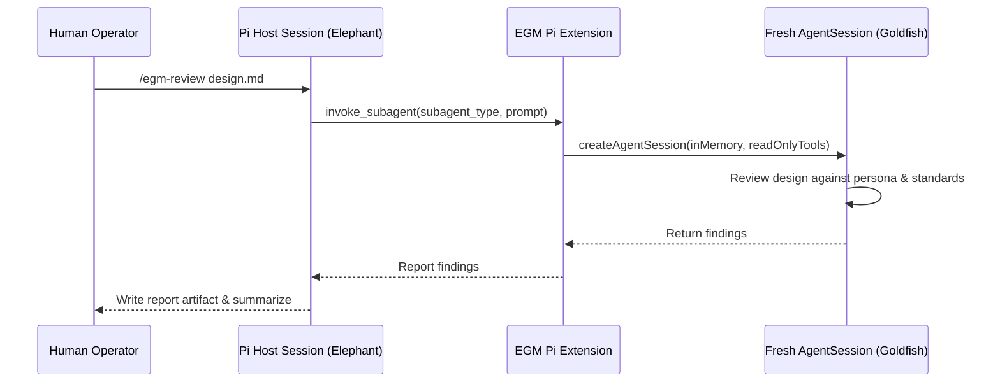

# Pi Package and NPM Distribution

Status: Current.
Author: @google. Date: 2026-10-27.

## Problem and Scope

Pi (`https://pi.dev/packages`) is an extensible coding agent harness that installs and
distributes packages via npm registries, git repositories, or local directories.
Users need an official Elephant-Goldfish Model package for Pi installable via `pi install npm:...`.

This design specifies the Pi package manifest, extension delegation layer, prompt
templates, and npm packaging boundaries for EGM.

## Goals

1. **Native Pi Package Distribution**: Publish EGM to the npm registry with `"keywords": ["pi-package"]` so it is discoverable in `https://pi.dev/packages` and installable via `pi install npm:...`.
2. **Strict Goldfish Isolation**: Ensure Goldfish reviewers run in isolated in-memory sessions with zero parent conversation history.
3. **Strict Read-Only Tool Protocol**: Guarantee that reviewer subagents have only read-only tools (`read`, `grep`, `find`, `ls`) and no write, edit, or shell capabilities.
4. **Zero Skill Forks**: Reuse the canonical `skills/`, `agents/`, and `resources/` verbatim without text duplication.
5. **Prompt Templates & Slash Commands**: Provide Pi prompt templates (`prompts/*.md`) and slash commands for `/egm-review`, `/egm-brainstorm`, `/egm-draft`, `/egm-resolve`, `/egm-bootstrap`, and `/egm-drift-report`.

## Non-Goals

1. Modifying the canonical Agent Skills text in `skills/*/SKILL.md`.
2. Bundling host-provided packages (`@earendil-works/pi-coding-agent`, etc.) in npm `dependencies`.
3. Auto-approving filesystem writes outside the configured artifact directory.

## System Architecture

### 1. Manifest (`package.json`)
The root `package.json` declares the package metadata, peer dependencies on host-provided Pi packages, the `pi` resource mapping, and an allowlist of files to publish to the npm registry:
- Peer dependencies: `@earendil-works/pi-coding-agent`, `@earendil-works/pi-ai`, `@earendil-works/pi-agent-core`, `@earendil-works/pi-tui`, `typebox` with `*` range.
- Host-provided packages must never appear in `dependencies`.
- `pi` section declares extensions (`extensions/index.ts`), skills (`skills/`), prompts (`prompts/*.md`), and icon (`assets/icon.svg`).
- `files` allowlist includes only runtime resources and excludes development files (tests, CI, Python scripts).

### 2. Extension Delegation (`extensions/index.ts`)
The extension registers `invoke_subagent`:
- Resolves requested persona from `agents/<name>.md` relative to the installed package root (`import.meta.url`).
- Selects tool sets based on persona:
  - Reviewers (`egm-zoom-out`, `egm-comprehension`, `egm-design`, `egm-structural`, `egm-style`, `egm-implementation-readiness`, `egm-codebase-details`): `createReadOnlyTools(cwd)`.
  - Synthesizer (`egm-synthesizer`): read-only tools + `createWriteTool(cwd)` + recursive `invoke_subagent`.
  - Bootstrap (`egm-bootstrap`): read-only tools + `createWriteTool(cwd)` + `createEditTool(cwd)` + `createBashTool(cwd)` + recursive `invoke_subagent`.
- Spawns a child session via `createAgentSession({ sessionManager: SessionManager.inMemory(), cwd, tools, model })`.
- Captures assistant output, disposes the child session, and returns the review report.

### 3. Prompt Templates (`prompts/`)
Markdown files under `prompts/` provide command autocompletion and argument hints in the Pi editor:
- `prompts/egm-review.md`
- `prompts/egm-brainstorm.md`
- `prompts/egm-draft.md`
- `prompts/egm-resolve.md`
- `prompts/egm-bootstrap.md`
- `prompts/egm-drift-report.md`

## Verification Strategy

1. **Manifest Drift Checks**: Automated unit test verifies `package.json` version, name, description, author, and license match `plugin.json`.
2. **Packaging Verification**: `scripts/pack_plugin.py --target pi` and `npm pack --dry-run` assert that all required runtime files exist and no development files are packaged.
3. **Isolation Contract**: Automated tests verify that child sessions use in-memory session managers and cannot access parent session history.
4. **Tool Sandboxing**: Reviewers are strictly verified to lack write, edit, and bash tools.
